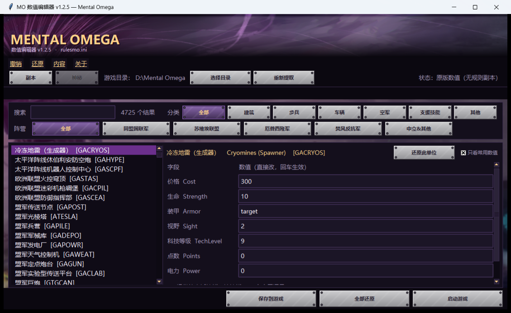

# MO 数值编辑器（MOINIEditor）

给 **Mental Omega 3.3.6**（RA2/YR 引擎 + Ares）用的中文数值编辑器。
不用解包、不用改 `.mix`，想改谁就搜谁，改完点一下保存，进游戏即生效；点「全部还原」立刻回到原版。

> 非官方工具。与 Mental Omega 制作组、Ares、CnCNet 均无关系。



## 它能做什么

- **中文搜索**：输入「骑士」「超时空采矿车」直接定位，也能搜英文名或单位 ID（`MTNK`）。
- **分类浏览**：阵营（同盟国联军 / 苏维埃联盟 / 厄普西隆军 / 焚风反抗军 / 中立&其他）× 类型（建筑 / 步兵 / 车辆 / 空军 / 支援技能 / 其他），按钮跟着阵营换配色。
- **改数值**：价格、生命、速度、视野、科技等级、电力……字段全部中文标注（覆盖率 95%+）。
- **改武器**：单位面板里直接展开它用的武器（含加特林各段位、精英武器），能改伤害 / 射速 / 射程 / 连发 / 弹头，弹头还能跳到弹头页改「对各类装甲的伤害系数」。
- **派生与部署**：飞毛腿这类发射器会列出它生成的导弹；基地车会列出展开后的建筑，并可直接改那个建筑的数值。
- **支援技能**：单独一栏，能改冷却 / 花费 / 效果范围 / 技能伤害 / 弹头，还能改它挂在哪栋建筑上、空投或传送出来的单位列表。
- **安全兜底**：撤销 / 还原（Ctrl+Z / Ctrl+Y）、改动清单窗口、数值格式与「步兵移速超过 15」的黄色警告、造不出来的条目自动灰显、保存前自动备份。
- **副本**：把当前这套改动存成副本，也能导出成 json 文件发给别人导入（联机前对表方便）。
- **小工具**：自动识别游戏目录、面板里直接启动游戏、记住窗口位置、启动时的一次性免费声明。

## 怎么用

1. 下载 [Releases](../../releases) 里的 `MO数值编辑器.exe`，双击运行（无需安装 Python）。
2. 首次启动会自动找游戏目录（要含 `gamemd.exe` 的那层，一般是 `D:\Mental Omega`），找不到就点「选择目录」。
3. 搜索 → 选中 → 右边改数字（回车生效）。
4. 点「保存到游戏」，**重启游戏**生效。
5. 想回原版：点「全部还原」，它只是删掉自己生成的那个 `rulesmo.ini`。

首次运行会在 exe 同目录建一个 `MOINIEditor_data\` 放备份和中文名表；若该目录不可写，会退到 `%LOCALAPPDATA%\MOINIEditor`。

## 原理（为什么不用改 mix）

- 游戏的规则文件 `rulesmo.ini` 打包在 `expandmo99.mix` 里。本工具**只读**它，从不解包、不修改任何 `.mix`。
- 保存时把原版 `rulesmo.ini` 原样复制一份到游戏根目录（松散文件会覆盖 mix 内的同名文件），然后**就在这份副本里就地改掉你动过的那几个键**，其余字节不动。
- 「全部还原」= 删掉这个副本文件。

细节和踩过的坑写在 [docs/开发笔记.md](docs/开发笔记.md)。

## 从源码运行

需要 Python 3.10+（带 tkinter）：

```bat
python app\moini.pyw
```

也可以直接双击 `启动.bat`（会依次找同目录 `python\pythonw.exe`、DSH 运行时、PATH 里的 pythonw）。

## 自己打包 exe

`_打包工具\` 里是打包脚本，详见 [_打包工具/README.md](_打包工具/README.md)。要点：

```bat
python _打包工具\fetch.py     :: 第一次：下载 PyInstaller 等 wheel 到 pylibs\
python _打包工具\build.py     :: 出单文件 exe + 文件夹版
```

**别用被裁剪过的 Python 打包**：缺少 `email` 模块会让 `importlib.metadata` 报错（本项目自带的 `python\` 就是裁剪版，只够运行、不够打包）。

## 兼容与限制

- 只对**单机**改动。联机时房主与其他人需要有**完全一致**的 `rulesmo.ini`（把改好的文件发过去覆盖即可）；MO 版本不同步时先点「重新提取」再改。
- MO 更新后点一下「重新提取」，重新从新 mix 取基准值。
- 未做：单位/技能的模板克隆、IFV 换装逻辑、武器库独立页（见 issues 与 `更新记录.md`）。

## 许可

[MIT](LICENSE)。游戏本体与素材版权归 Mental Omega 制作组（Mentalmeisters）所有，本项目只包含自写的代码与自己整理的中文名表。

## 致谢

- **MadNod（MadNod_）**：需求、玩法设计、游戏内逐项实测与验收，「这里不对」的反馈全是他一条条试出来的。
- **DeepSeek Harness（AI 助手）**：代码实现、MIX 容器解析、`rulesmo.ini` 结构分析、官网中文名抓取与节 ID 映射、界面美术与打包。
- 中文名数据来自 [mentalomega.com 中文站](https://mentalomega.com/ch/index.php?page=factions)，版权归其作者。
